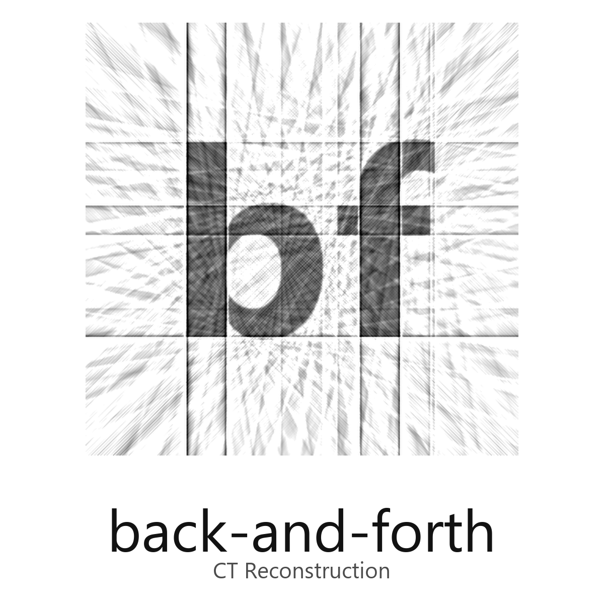

# back-and-forth

  

This is the official public download and user-documentation repository for
**back-and-forth**. Application source code and development history are not
published in this repository.

back-and-forth is a Windows CT reconstruction tool that currently only supports
Nikon XT CT scanners. It reads Nikon projection TIFF series and XTek metadata,
guides users through center-of-rotation selection, beam-hardening correction,
cropping, reconstruction, and optional supervised NMAR, and writes float32
`.vgi`, `.vol`, and Nikon-style `.xtekct` outputs. It can also load an existing
Nikon VGI/VOL reconstruction for archival Distribution export and PLY
isosurface creation.

This is research software for non-clinical CT reconstruction and archival
scientific workflows. It is not intended for clinical diagnosis, treatment
planning, regulated inspection, or other safety-critical decisions.

## Download

Open the [latest release](https://github.com/AdamRountrey/back-and-forth-releases/releases/latest)
and download the file named `back-and-forth-<version>-windows-x64.zip` together
with its `.sha256` checksum. Do not use GitHub's automatically generated
**Source code** archives; those contain only this documentation repository.

Extract the Windows ZIP to a local folder and run `back-and-forth.exe`. The
package includes its Qt, Visual C++, CUDA runtime, and cuFFT dependencies. CUDA
acceleration requires a compatible NVIDIA driver and supported NVIDIA GPU; CPU
methods remain available when CUDA is unavailable.

## Supported Data

- Nikon XT/XTek circular cone-beam projection TIFF series with XTekCT metadata.
- Nikon float32, unsigned 16-bit, and explicitly signed 16-bit VGI/VOL
  reconstructions with post-reconstruction XTekCT metadata for archival
  Distribution export, thumbnail previews, and PLY isosurfaces. Imported raw
  VOL data must be headerless and little-endian.
- Complete 360-degree, valid short-scan, true limited-angle, and recoverable
  displaced-detector acquisitions are classified separately.

True tilted rotation-axis scans with nonzero Nikon `ObjectTilt` are detected but
are not supported. Severe truncation and interior-region scans are incomplete
inverse problems; warnings and iterative methods do not make them uniquely
quantitative without additional assumptions.

## Quick Start

On startup, choose one workflow:

1. **Reconstruct from projections**: open the scan folder, select COR planes,
   refine and review COR, select beam-hardening correction, crop in the
   low-resolution reconstruction preview, enter optional specimen metadata, and
   run the selected reconstruction.
2. **Load/Export existing VGI/VOL**: open the VGI or parent scan folder, verify
   the discovered XTekCT/XML metadata, enter specimen metadata, preview the
   volume thumbnail, and export the Distribution package.

The guidance bar at the top of the application identifies the next recommended
step. Long operations show progress and reconstruction can be aborted.

## Documentation

- [User guide](docs/user-guide.md): complete GUI workflows, file discovery,
  outputs, saved jobs, and network storage.
- [Center of rotation](docs/center-of-rotation.md): plane selection, automatic
  refinement, candidate review, and scan-specific cautions.
- [Nikon metadata compatibility](docs/nikon-metadata.md): CIL-readable
  acquisition geometry, Nikon final-volume fields, and reconstruction
  provenance.
- [Metadata reference](docs/metadata-reference.md): field-by-field XTekCT,
  VGI/VOL, combined JSON, and Nikon XML evidence status, units, value origins,
  parser/writer behavior, and explicitly unidentified proprietary fields.
- [Reconstruction methods](docs/reconstruction-methods.md): algorithm selection,
  controls, memory behavior, and limitations.
- [Limited-angle and offset scans](docs/limited-angle-and-offset-reconstruction.md):
  short-scan, missing-angle, displaced-detector, and truncation cases.
- [Beam hardening](docs/beam-hardening-correction.md) and
  [metal artifact correction](docs/nmar.md): supervised Meyer NMAR,
  segmentation review, and required interpretation.
- [PLY isosurface export](docs/isosurface-export.md): interactive threshold
  selection, full-resolution corrected-MC33 surfaces with subvoxel edge
  localization, and optional surface-attached attenuation depth maps.
- [Citations](docs/citations.md) and
  [scientific validation](docs/scientific-validation.md): method provenance,
  numerical checks, comparison scope, and reproducibility details.

## Network Storage

When projections or an existing VGI/VOL are opened from network storage,
back-and-forth can stage workflow inputs into a persistent local scratch cache.
The copy dialog reports byte-level progress and supports cancellation. Completed
files are reused only while source size and modification time still match;
interrupted copies are never treated as valid cache data.

Distribution packages bound for network storage are generated, compressed, and
verified in local scratch before a buffered, byte-progressed publication step.
The destination is updated transactionally; a failed network publication keeps
the previous package intact and preserves the completed local package for
recovery.

## AI Assistance Disclosure

AI assistance from OpenAI GPT-5.5 was used to help produce code, documentation,
tests, and review notes for this project under the guidance of human
contributors. Human contributors directed the scientific requirements, reviewed
algorithm choices, and tested outputs.

## Disclaimer Of Warranty And Limitation Of Liability

back-and-forth and associated information are provided on an "as is" and "as
available" basis. To the maximum extent permitted by applicable law, the authors
and contributors disclaim all warranties or conditions, whether express,
implied, statutory, or otherwise, including title, non-infringement,
merchantability, fitness for a particular purpose, accuracy, reliability,
availability, or compatibility. The authors and contributors have no obligation
to provide maintenance, support, updates, corrections, or continued access.

To the maximum extent permitted by applicable law, the authors and contributors
shall not be liable under any legal or equitable theory for direct,
consequential, incidental, indirect, exemplary, special, enhanced, or punitive
damages; increased costs; diminution in value; lost business, production,
revenue, profits, goodwill, or reputation; loss, interruption, delay, or
recovery of data; breach of data or system security; or replacement costs,
regardless of foreseeability or prior notice. This supplements the warranty and
liability disclaimer in the MIT License.

## License And Notices

back-and-forth is licensed under the [MIT License](LICENSE). This repository is
an official binary distribution channel and does not contain the application
source code. Third-party runtime notices are listed in
[THIRD_PARTY_NOTICES.md](THIRD_PARTY_NOTICES.md) and are also included in the
Windows package.
