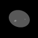
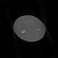
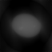
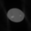

# Reconstruction Methods

Back-and-forth classifies angular coverage, detector displacement, truncation,
and available memory, then displays a suggested reconstruction method. The
suggestion is advisory. The scientifically appropriate choice depends on which
data are actually present, the expected specimen structure, noise, runtime, and
whether quantitative attenuation or visual artifact suppression is the goal.

## Quick Selection Guide

1. For an ordinary, well-sampled 360-degree Nikon scan, begin with **standard
   FDK using Ram-Lak**.
2. For a continuous short scan that covers at least approximately 180 degrees
   plus the full fan angle, use **Parker-weighted FDK**.
3. For a 360-degree offset-detector scan whose complementary views recover the
   object, use **displaced-detector FDK**.
4. For true limited-angle or substantially few-view data, begin with **CGLS**.
   It is the default iterative suggestion because it usually reaches a useful
   least-squares solution in fewer iterations than SIRT.
5. Try **normalized SIRT** when CGLS amplifies noise or model mismatch, when a
   non-negative solution is important, or when smoother, steadier convergence
   is preferable to speed.
6. Try **OS-SART** when faster visible progress is important and an appropriate
   relaxation and subset size can be reviewed. It is usually more practical
   than projection-wise SART for large scans.
7. Use **TV-CP** only when a piecewise-smooth image prior is scientifically
   defensible and the solver state fits in GPU or system memory. Compare it
   carefully with a non-TV result to ensure fine anatomy has not been removed.
8. Use **NMAR** when dense pyrite or metal creates severe streaks and a user can
   supervise the material segmentation. NMAR is a correction workflow, not a
   general replacement for FDK or iterative reconstruction.
9. Do not use NMAR when the physical metal trace is exposed to air or lies
   outside specimen support. back-and-forth currently has no production MAR
   route for that geometry.

No algorithm can recover information that was never measured. In particular,
a smooth limited-angle or interior reconstruction can still contain invented or
prior-dominated structure.

## Summary

| Method | Consider it when | Main tradeoff | Large-volume execution |
| --- | --- | --- | --- |
| Standard FDK | Complete, well-sampled circular scan | Fast and sharp; sensitive to noise, COR, motion, and incomplete data | CPU reference or streamed CUDA |
| Parker FDK | Valid continuous short scan | Corrects angular redundancy; cannot repair a true missing-angle acquisition | CPU or CUDA FDK |
| Displaced-detector FDK | Recoverable 360-degree offset scan | Expands usable field of view; cannot recover an interior region never measured by complementary views | CPU or CUDA FDK |
| CGLS/CGNR | First iterative choice for limited-angle or few-view data | Fast least-squares convergence; no positivity or explicit noise prior | CPU, resident CUDA, or host-RAM/disk-streamed CUDA |
| Normalized SIRT | Noisy or inconsistent data needing stable, optionally non-negative updates | Robust and smooth, but usually needs more iterations | CPU, resident CUDA, or host-RAM/disk-streamed CUDA |
| SART | Small or moderate problems needing rapid projection-wise updates | Order- and relaxation-sensitive; no out-of-core CUDA path | CPU or resident CUDA |
| OS-SART | Faster algebraic iteration with controllable subsets | Can amplify noise or enter subset limit cycles | CPU, resident CUDA, or host-RAM/disk-streamed CUDA |
| TV-CP | Few-view/limited-angle data with a defensible piecewise-smooth prior | Suppresses noise and streaks but can staircase or erase fine structure | CPU or resident CUDA |
| ASD-POCS ART-TV | Experimental comparison with constrained TV literature | CPU-only and parameter-sensitive | CPU only |
| TpV-GIF inspired | Experimental sparse-angle method comparison | Not a literal cone-beam implementation of the cited TpV-GIF paper | CPU only |
| NMAR | Severe dense-inclusion streaks with supervised segmentation | Incorrect masks or priors can replace real structure | Multi-stage CUDA-accelerated workflow |

## Synthetic Limited-Angle Example

The images below use the same center XY slice from a controlled `65 x 65 x 65`
phantom with Nikon-style cone-beam geometry: source-to-object distance `50 mm`,
source-to-detector distance `200 mm`, a `64 x 64` detector, and all 101
projections from 0 through 150 degrees in 1.5-degree steps. This is true
limited-angle data, not a Parker-complete short scan. Projections use exact
continuous line integrals through the analytic phantom; displayed truth uses
deterministic `4 x 4 x 4` subvoxel averaging so it represents finite voxel
values rather than isolated center samples.

<table>
  <tr>
    <th>Analytic truth</th>
    <th>Limited-angle FDK</th>
    <th>CGLS</th>
  </tr>
  <tr>
    <td><a href="images/algorithm-examples/limited150_truth_xy.png"></a></td>
    <td><a href="images/algorithm-examples/limited150_fdk_xy.png"></a></td>
    <td><a href="images/algorithm-examples/limited150_cgls_xy.png"></a></td>
  </tr>
  <tr>
    <th>Normalized SIRT</th>
    <th>OS-SART</th>
    <th>TV-CP</th>
  </tr>
  <tr>
    <td><a href="images/algorithm-examples/limited150_sirt_xy.png"></a></td>
    <td><a href="images/algorithm-examples/limited150_os_sart_xy.png"></a></td>
    <td><a href="images/algorithm-examples/limited150_tv_cp_xy.png"></a></td>
  </tr>
</table>

The fixed comparison used Ram-Lak FDK and 16 iterations for CGLS, normalized
SIRT, OS-SART, and TV-CP. SIRT and OS-SART used
relaxation `0.2` and non-negativity; OS-SART used 8 views per subset. TV-CP used
TV weight `0.03`, primal step `0.004`, dual step `0.006`, and non-negativity.

For display only, each reconstruction was multiplied by its independently
calculated least-squares multiplier to truth and shown with one fixed window
from zero to `1.05` times the truth maximum. The images therefore compare
structure and artifact character, not absolute attenuation calibration. The
unrounded metrics and fitted display multipliers are in
[limited150_metrics.csv](images/algorithm-examples/limited150_metrics.csv).

The scaled global NRMSE values for this fixed run were OS-SART `0.111`, CGLS
`0.161`, TV-CP `0.262`, FDK `0.298`, and SIRT `0.445`. OS-SART scoring best here
does not establish a universal ranking: this phantom is noiseless, its geometry
matches the reconstruction model, and every iterative method was stopped after
the same 16 iterations without method-specific tuning. In particular, 16 SIRT
iterations represent an early iterate, while OS-SART performs multiple subset
updates per iteration. Use the images to recognize missing-angle streaks,
unconstrained least-squares structure, simultaneous-update smoothing, subset
behavior, and TV smoothing. Do not use them as default parameter optimization
for a specimen.

## Analytic FDK Methods

### Standard FDK

FDK filters each attenuation projection along detector rows, applies cone-beam
geometric weighting, and backprojects the filtered values into the volume. It
has no iterative stopping or regularization parameters and is much faster than
the algebraic methods.

Choose standard FDK for complete, reasonably well-sampled 360-degree circular
scans with reliable geometry and COR. It is the clearest baseline when spatial
resolution and reproducible attenuation scaling matter. It also provides a
useful comparison image before selecting an iterative method.

FDK is sensitive to incorrect COR, motion, truncation, beam hardening, and
insufficient angular sampling. Circular cone-beam FDK is approximate away from
the central plane because an ordinary circular source trajectory does not meet
the general three-dimensional cone-beam completeness condition. Do not interpret
its speed as evidence that it is valid for true limited-angle data.

### Parker-Weighted Short-Scan FDK

Parker weighting compensates for the nonuniform angular redundancy of a
continuous short scan before FDK backprojection. Use it only when the measured
arc reaches the short-scan completeness requirement, approximately 180 degrees
plus the full fan angle, and when the angle sequence represents a suitable
continuous acquisition.

Parker weighting is not a generic limited-angle correction. If angular coverage
falls below the requirement or contains a substantial missing wedge, use an
iterative method and retain a missing-data warning.

### Displaced-Detector FDK

Displaced-detector weighting combines redundant rays from complementary views
in a 360-degree offset acquisition. It is appropriate when moving the detector
or object off center expands the field of view and opposite views collectively
measure the full object.

Use this method only when the scan is classified as recoverable from
complementary views. It does not solve severe truncation or interior tomography
when part of the specimen is absent from every relevant ray set.

## FDK Filter Choice

- **Ram-Lak** is the default. It retains the full ramp response and therefore
  the most high-frequency detail, along with high-frequency noise.
- **Shepp-Logan** multiplies the ramp by a sinc window. It can reduce noise and
  ringing with a modest loss of high-frequency response.
- **Cosine**, **Hann**, and **Hamming** apply conventional frequency windows.
  Their detailed frequency responses differ, but all trade edge resolution for
  reduced high-frequency noise and streak texture.
- **Cutoff** is expressed as a fraction of detector Nyquist. A cutoff of `1.0`
  uses the full available band; lowering it is an additional low-pass choice.

Use Ram-Lak first for high-resolution microCT with adequate signal. Select a
windowed filter because the data require a documented noise-resolution tradeoff,
not merely because the result looks smoother. Filter choice changes the spatial
frequency response and should remain constant across scans being compared
quantitatively.

## Iterative Methods

All iterative methods use the measured Nikon cone-beam geometry and a matched
forward/backprojector pair. They repeatedly compare a projected estimate with
the measured attenuation projections. They can handle incomplete data more
gracefully than FDK, but they do not make an incomplete inverse problem unique.

### CGLS/CGNR

CGLS minimizes the unregularized projection-domain least-squares objective

```text
minimize 0.5 * ||A x - b||_2^2.
```

It uses conjugate search directions for the normal equations and generally
reduces residual error in fewer iterations than SIRT. Back-and-forth therefore
suggests CGLS first for true limited-angle, few-view, and difficult offset or
truncated cases that require an iterative reconstruction.

CGLS has no positivity constraint and no explicit edge-preserving or denoising
prior. Early stopping is its practical regularization: later iterations may fit
noise, motion, beam-hardening residuals, truncation mismatch, or other model
errors. Review the iteration preview and residual history rather than assuming
that more iterations are always better.

### Normalized SIRT

Normalized SIRT forms a simultaneous correction from all projections, using ray
and voxel sensitivity normalization before applying the update. Optional
non-negativity can prevent physically implausible negative attenuation.

Choose SIRT when stable, gradual convergence is more useful than the faster
least-squares progress of CGLS, especially for noisy or inconsistent data. SIRT
often appears smoother at the same early stage, but it is not an edge-preserving
regularizer and usually requires more iterations and more time.

Relaxation controls the correction magnitude. Excessive relaxation can cause
oscillation or divergence; overly small relaxation can make progress needlessly
slow.

### SART

SART applies a normalized correction after each projection. It can produce
recognizable structure quickly, which is useful for smaller few-view problems
or method comparisons.

Because updates are projection-wise, the result is sensitive to projection
order and relaxation. Aggressive settings can amplify noise or oscillate. CUDA
SART requires resident solver state, so it is not the preferred choice for a
volume that exceeds GPU memory.

### OS-SART

OS-SART groups projections into ordered subsets and applies one normalized image
update per subset. It preserves the SART formulation while reducing update
overhead and often reaches a useful image faster than SIRT.

The subset size is specified in views per subset. A practical initial range is
8-32 views per subset. Smaller subsets update more frequently and may converge
quickly, but are more sensitive to noise and subset limit cycles. Larger subsets
are steadier and move toward SIRT-like simultaneous behavior. Compare at least
one alternative subset size when OS-SART output will be used quantitatively.

### TV-CP

TV-CP uses the Chambolle-Pock primal-dual method to solve

```text
minimize 0.5 * ||A x - b||_2^2 + lambda * TV_iso(x),
```

with an optional non-negativity constraint. Isotropic total variation favors a
sparse spatial gradient, so it can strongly reduce noise and missing-angle
streaks in objects that are genuinely close to piecewise smooth.

Choose TV-CP for few-view or limited-angle data when that prior matches the
specimen and preserving every weak texture is not the only goal. Excessive TV
weight can flatten subtle attenuation variation, remove pores or thin features,
and produce staircase-like regions. TV-CP currently requires resident solver
state for CUDA execution, making it less suitable for very large volumes.

## Experimental Methods

### ASD-POCS ART-TV

The ASD-POCS option alternates projection-consistency/positivity updates with
adaptive steepest descent of isotropic TV, following the Sidky-Pan constrained
TV structure. It is CPU-only, computationally expensive, and exposes several
interacting parameters. Use it for research comparison with the constrained-TV
literature, not as the routine default for production volumes.

### TpV-GIF Inspired

This CPU-only option is an experimental sparse-angle comparison inspired by the
published TpV-GIF workflow. Its guided-image-filter stage is available, but the
paper's Fourier-domain update is not a literal fit to back-and-forth's Nikon
cone-beam operator. Do not describe or cite its output as a literal reproduction
of the published cone-beam method.

## Dense-Inclusion Correction

NMAR is intended for severe streaks from pyrite, metal, or similarly dense
inclusions. It reconstructs an initial volume, segments the dense material,
creates a corrected material prior, forward-projects the mask and prior,
interpolates the normalized dense-material trace, and performs a final
reconstruction.

Choose NMAR only when dense inclusions are the dominant artifact source and the
air, specimen, dense-specimen, and metal/pyrite classes can be reviewed. A mask
that is too small leaves streaks; a mask or prior that includes ordinary anatomy
can replace real measured structure. Inspect the initial reconstruction, dense
mask, prior classes, corrected orthogonal slices, and the uncorrected result.

See [nmar.md](nmar.md) for the exact correction sequence and picker domains.

If metal is exposed to air, an NMAR prior projection can approach zero at the
metal-trace boundary and make normalized interpolation unstable. back-and-forth
detects unsupported interpolation runs rather than extending specimen labels
into real air. No production correction route is currently recommended for
external rods, electrodes, fixtures, or inclusions that genuinely contact air.

## Iteration And Constraint Controls

- **Iterations** determine how long the solver fits the data. More iterations
  can improve resolution and also amplify noise or model mismatch.
- **Relaxation** applies to SIRT, SART, and OS-SART. It controls update size, not
  image sharpness directly.
- **Subset size** applies to OS-SART and is measured in projection views.
- **Non-negative** is available for methods whose formulation includes a
  positivity projection. Published CGLS remains unconstrained.
- **TV weight** controls the balance between projection fidelity and isotropic
  total variation in TV-CP.

Always record the requested and completed iteration counts, relaxation, subset
size, non-negativity setting, TV weight, projector, filter, corrections, and
warnings with the reconstructed dataset.

## Crop And Model Validity

An iterative solver models the selected reconstruction volume as the complete
attenuating object. If measured rays pass through specimen material outside the
crop, the modeled projections cannot match the measured projections. This is a
model inconsistency, not an ordinary crop optimization.

Use a full-object reconstruction volume for iterative and NMAR work unless a
validated interior-tomography method is explicitly being used. Back-and-forth
warns before cropped iterative and NMAR runs, but accepting the warning does not
turn these algorithms into interior reconstruction methods.

## Memory And Runtime

Back-and-forth estimates solver state before reconstruction:

1. GPU-resident execution is selected when the complete state fits inside a
   conservative GPU-memory budget.
2. Host-RAM-backed streaming is selected when GPU memory is insufficient but
   system memory can hold the slab and projection cache.
3. Local-disk streaming is selected when neither resident tier fits.

Streaming preserves the global CT operator. Volume slabs are storage and
scheduling units; they are not reconstructed as independent CT problems.
Streaming is available for FDK, normalized SIRT, OS-SART, and CGLS. It permits
larger jobs but adds data-transfer and storage overhead.

SART and TV-CP require resident CUDA state. ASD-POCS and TpV-GIF inspired are
CPU-only. NMAR performs several reconstructions and forward projections, so it
can take much longer than one FDK reconstruction even when CUDA is active.

## Comparing Methods

When comparing algorithms, hold geometry, COR, crop, projection set, beam
hardening, output voxel size, and display window constant. Inspect XY, XZ, and
YZ slices at full resolution and include regions with fine edges, low contrast,
and known artifact susceptibility.

Do not select a method solely because it produces the smoothest or most visually
pleasing image. Where possible, use calibrated reference materials, repeated
features, projection residuals, and task-specific quantitative measurements.
Record every parameter needed to reproduce the comparison.

See [limited-angle-sirt.md](limited-angle-sirt.md) for iterative equations,
[limited-angle-and-offset-reconstruction.md](limited-angle-and-offset-reconstruction.md)
for scan classification, [citations.md](citations.md) for publications, and
[scientific-validation.md](scientific-validation.md) for numerical comparisons.
