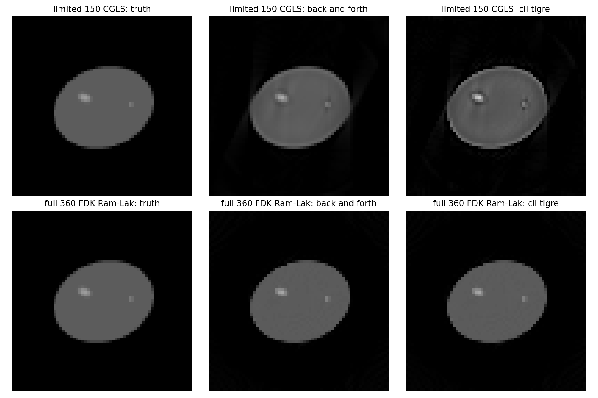

# Scientific Validation

Numerical validation addresses two separate questions:

1. Are back-and-forth's discrete forward and backprojectors internally
   consistent?
2. Do its geometry and reconstructions agree with analytic truth and an
   independent cone-beam implementation?

These tests provide bounded evidence for the stated operators, acquisition
geometries, and parameters. They do not guarantee accuracy for every specimen,
scanner calibration, correction, or incomplete-data condition.

## Projector Adjointness

The iterative solvers require a matched discrete projector pair satisfying

```text
<A x, y> = <x, A^T y>.
```

Deterministic tests exercise the production CPU Joseph, CPU voxel-splat, and
CUDA Joseph paths. The current measured relative residuals are:

| Projector pair | Relative adjointness residual | Test tolerance |
| --- | ---: | ---: |
| CPU Joseph | `3.69e-9` | `2e-6` |
| CPU voxel-splat | `5.92e-9` | `2e-6` |
| CUDA Joseph | `1.35e-8` | `2e-5` |

These values establish numerical consistency between each implemented forward
operator and its matched adjoint. They do not establish agreement with
continuous X-ray physics by themselves.

## Independent CIL/TIGRE Comparison

The independent comparison uses CIL 25.0.0 and TIGRE 2.6.0. CIL reads the same
Nikon-style XTekCT files and unsigned 16-bit transmission TIFFs as
back-and-forth, then performs its own transmission-to-absorption conversion,
geometry construction, forward projection, CGLS, and FDK.

The current benchmark uses:

- an asymmetric analytic phantom containing rotated boundaries, cavities,
  low-contrast domains, and small off-axis features;
- exact continuous cone-beam line integrals through every phantom ellipsoid;
- no detector shading, noise, beam hardening, truncation, or material
  correction;
- 160 unique views over `[0, 360)` plus one excluded `360`-degree wrap frame;
- 101 views from `0` through `150` degrees for the limited-angle case;
- one common `128 x 128` detector with `0.2 mm` pixels, a `25.6 mm`
  physical field, `50 mm` source-to-object distance, and `200 mm`
  source-to-detector distance in both scenarios;
- all projections and a `65 x 65 x 65` reconstruction grid spanning the
  complete synthetic object;
- truth voxel values estimated as volume averages by deterministic
  `4 x 4 x 4` subvoxel quadrature;
- 16 unconstrained CGLS iterations using the production CUDA Joseph projector;
- Ram-Lak FDK with cutoff `1.0` for the complete full scan.

CIL/TIGRE uses its interpolated forward projector with matched adjoint weights.
Its discretization is independent from back-and-forth's Joseph projector.
Within each scenario, both programs read the exact same XTekCT file and TIFF
bytes. The generated JSON records SHA-256 identities for the metadata and each
projection set.
The harness also sends the same voxel-averaged truth through back-and-forth's
production CUDA Joseph forward projector and compares both forward models
directly with the same synthetic attenuation TIFFs.

### Metric Definitions

Each candidate reconstruction `x` is reported both unscaled in the machine-
readable CSV and after one least-squares fit to truth `t`:

```text
alpha = <x,t> / <x,x>.
```

The table's **LS multiplier** is `alpha`, the number applied to the candidate
for the scaled comparison. It is not a physical calibration coefficient and is
never applied to production reconstruction output.

- **Global NRMSE** includes the complete volume and therefore penalizes both
  specimen error and background artifacts.
- **Support NRMSE** is evaluated where analytic truth contains specimen.
- **Gradient NRMSE** compares all three scaled spatial-gradient components and
  is more sensitive to edge position and blur.
- **Background ratio** is reconstructed RMS outside a one-voxel dilation of
  truth support, divided by truth RMS inside support.

For projection-space comparisons, the same formulas are applied to detector
samples. Projection background is the set of samples whose measured
attenuation is below `1e-6` of the maximum measured attenuation; it is not
dilated.

### Forward-Model Results

| Scenario | Forward model | Global NRMSE | Support NRMSE | Global correlation | Background ratio | LS multiplier |
| --- | --- | ---: | ---: | ---: | ---: | ---: |
| 150-degree geometry | back-and-forth CUDA Joseph | `0.024635` | `0.015175` | `0.9996062` | `0.011728` | `1.002910` |
| 150-degree geometry | CIL/TIGRE interpolated | `0.024637` | `0.015173` | `0.9996061` | `0.011730` | `1.002910` |
| Full-rotation geometry | back-and-forth CUDA Joseph | `0.024484` | `0.015165` | `0.9996096` | `0.011705` | `1.002876` |
| Full-rotation geometry | CIL/TIGRE interpolated | `0.024485` | `0.015164` | `0.9996095` | `0.011706` | `1.002879` |

The two independently implemented forward models have effectively the same
error magnitude against the analytic synthetic measurements in these cases;
back-and-forth is fractionally lower on the reported norms. This rules out a
gross B&F geometry, sign, or attenuation-scale error as the explanation for
the small reconstruction differences. It does not establish that the two
discrete operators are element-for-element identical: different spatial error
patterns and matched adjoints can still follow different finite-iteration
solver trajectories.

### Truth-Relative Results

| Scenario | Implementation | Global NRMSE | Support NRMSE | Gradient NRMSE | Global correlation | Background ratio | LS multiplier |
| --- | --- | ---: | ---: | ---: | ---: | ---: | ---: |
| 150-degree CGLS | back-and-forth | `0.13983` | `0.09064` | `0.39645` | `0.98923` | `0.02946` | `0.98189` |
| 150-degree CGLS | CIL/TIGRE | `0.21071` | `0.16374` | `0.71696` | `0.97556` | `0.03679` | `0.94425` |
| Full-rotation Ram-Lak FDK | back-and-forth | `0.07607` | `0.04370` | `0.23592` | `0.99713` | `0.01997` | `1.01226` |
| Full-rotation Ram-Lak FDK | CIL/TIGRE | `0.07600` | `0.04370` | `0.23568` | `0.99717` | `0.01994` | `1.01227` |

### Direct Implementation Agreement

| Scenario | B&F/CIL global NRMSE | B&F/CIL gradient NRMSE | Volume correlation | Gradient correlation |
| --- | ---: | ---: | ---: | ---: |
| 150-degree CGLS | `0.14749` | `0.39243` | `0.988120` | `0.930595` |
| Full-rotation Ram-Lak FDK | `0.00360` | `0.00880` | `0.999994` | `0.999961` |

The full-rotation FDK volumes are nearly indistinguishable numerically as well
as visually. At the same fixed 16-iteration stopping point, back-and-forth's
limited-angle CGLS result is closer to analytic truth on global, specimen,
gradient, correlation, and background metrics. This is evidence for this
specified dataset and stopping point, not a universal package ranking.

<a href="images/scientific-validation/contact_sheet.png"></a>

The orthogonal comparison is available as
[a full-resolution contact sheet](images/scientific-validation/orthogonal_contact_sheet.png),
all unrounded measurements are in
[validation_metrics.csv](images/scientific-validation/validation_metrics.csv),
and the detector geometry plus shared-input SHA-256 identities are in
[validation_results.json](images/scientific-validation/validation_results.json).

## Coordinate And Orientation Check

Back-and-forth VGI/VOL storage reverses Z relative to its internal ascending-
physical-Z arrays. The comparison reverses that storage axis once. CIL's Nikon
reader performs Nikon's in-plane angle conversion, and CIL/TIGRE's vertical
image index is then reversed once into back-and-forth's internal Z direction.

This fixed conversion is tested in projection space against plausible wrong
alternatives. It is not selected by a reconstruction score.

| Projection case | B&F expected geometry | CIL expected conversion | No Z conversion | Added X reversal | Added Y reversal |
| --- | ---: | ---: | ---: | ---: | ---: |
| 150-degree geometry | `0.02464` | `0.02464` | `0.10786` | `0.18477` | `0.18649` |
| Full-rotation geometry | `0.02448` | `0.02448` | `0.10894` | `0.18313` | `0.17743` |

The expected conversion is substantially better than every tested alternative.
Its residual is not zero because continuous analytic line integrals are being
compared with CIL/TIGRE projections of a finite voxel-basis approximation, and
the source TIFF values are quantized to unsigned 16-bit transmission.

## Why Results Differ

Back-and-forth and CIL/TIGRE are expected to differ slightly because they use
independent interpolation, matched adjoints, floating-point reductions,
angular quadrature, and FDK filtering/backprojection implementations. The
projection-space measurements show comparable forward-model accuracy, while
their strong direct reconstruction agreement shows that the remaining
implementation differences are small for the tested geometry.

For limited-angle CGLS, the truth-relative difference after 16 iterations is
consistent with different discrete operator-adjoint pairs and Krylov
trajectories, not with a less accurate B&F forward projection. CGLS is an
iterative regularization path, so equal iteration counts do not imply equal
points along two independently discretized paths. The fixed-count comparison
is nevertheless reproducible and uses identical measured data, geometry, and
output grids. For full-rotation FDK, the Joseph projector is not part of either
FDK reconstruction; the remaining 0.36% direct volume difference arises in the
separate filtering and backprojection paths and is negligible at the scale of
the truth-relative error.

Both packages differ more from analytic truth than from each other. Shared
sources include finite detector and voxel resolution, projection quantization,
the 150-degree missing wedge, finite CGLS iteration, and the incomplete
three-dimensional sampling of an ordinary circular cone-beam trajectory. A
smooth or high-correlation result is not evidence that missing information has
been recovered uniquely.

Earlier benchmark values are not retained because that benchmark combined
several confounds:

- the full-scan reconstruction set included both `0` and `360` degrees and was
  followed by another `360`-degree wrap frame;
- the limited-angle iterative volume excluded attenuating phantom material
  that was present in measured rays;
- synthetic detector shading was enabled without a matching flat-field
  correction;
- truth used one center sample per voxel rather than a finite voxel average;
- route-test datasets used only 64 full-scan and 41 limited-angle views.

The corrected synthetic generator and validation harness remove those
confounds. No production reconstruction algorithm or output attenuation scale
was adjusted to improve agreement with CIL/TIGRE.

## Polychromatic Gaussian Calibration Gate

The research-only Gaussian-splat path has a spatially independent validation.
A hard-edged `128^3` voxel phantom supplies two known attenuation-basis fields;
the production CUDA Joseph projector generates 240 cone-beam views, and the
published 15-component polychromatic equation combines the basis line
integrals. Every sixth angle is excluded before both Ram-Lak FDK initialization
and optimization, leaving 200 training and 40 held-out views. Training uses the
full released 20,000-step schedule.

That original validation still uses Choi et al.'s Equation 12 to synthesize the
measurements, so it does not independently test the fitted spectral model. A
second mode now supplies an independently generated 225 kVp tungsten spectrum
from SpekPy 2.5.4 and energy-dependent water, hydroxyapatite, and pyrite
attenuation from xraylib 4.2.1. It uses 215 one-keV components and a declared
ideal energy-integrating detector. The reconstruction still uses Choi et al.'s
published 15-component response, so the measurement and inverse models are no
longer identical. This is a reproducible synthetic stress model, not a Nikon
source or detector calibration.

Material attenuation is measured in one-voxel-eroded interior regions defined
from immutable truth labels, not from reconstructed thresholds. On separated
homogeneous inserts, held-out projection loss decreases from `0.380586` to
`0.001933`; reference-energy interior bias is `-6.40%` for specimen, `-9.60%`
for dense specimen, and `-6.43%` for metal. On the complex metal/air phantom,
held-out loss decreases from `0.620669` to `0.003571`, but the corresponding
biases are `+13.28%`, `-14.14%`, and `+31.53%`.

These results pass the current projection-generalization check but do not pass
a quantitative-attenuation calibration gate. In particular, the learned
response is not uniquely recovered across the two phantoms. The Gaussian
method remains hidden from the GUI and must not be described as quantitative
material recovery. Detailed definitions, limitations, and result paths are in
[gaussian-splat-mar.md](gaussian-splat-mar.md).

The independent-spectrum result strengthens that restriction. For separated
ideal inserts, non-air NRMSE is `0.67949` for Ram-Lak FDK, `0.69566` for
oracle-prior NMAR, and `0.60379` for Gaussian reconstruction, but Gaussian
metal attenuation is biased by `-61.28%`. For embedded metal, the same values
are `0.49874`, `0.45792`, and `0.63270`; Gaussian reconstruction suppresses
some radial streaks while introducing broad shading and `-58.91%`
ordinary-specimen bias. Held-out projection fit therefore remains a necessary
optimization check, not evidence of quantitative or structural correctness.

The same independent insert phantom now has a deterministic acquisition-stress
matrix. It samples Poisson quantum counts before the logarithm and separately
tests low counts, angle-localized detector clipping, a broad additive
scatter-like field, and a combined condition. Every parameter and affected
sample count is written to `metrics.txt`. These are literature-grounded stress
models, not measurements of the Nikon source, detector, or scatter field, and
they are not modifications to Choi et al.'s reconstruction method.

Across ideal, Poisson, low-count, saturation, scatter-surrogate, and combined
conditions, Gaussian non-air NRMSE is respectively `0.1686`, `0.1739`,
`0.3591`, `0.3203`, `0.2643`, and `0.3868`. It is lower than matched Ram-Lak
FDK and oracle-prior Meyer NMAR in this particular phantom, but dense-material
and metal attenuation remain biased. The recorded pass flag is therefore an
optimization regression gate only; `quantitative_attenuation_gate_passed`
remains false.

A separate historical native-resolution capacity test uses all 2,000 measured
`2000 x 2000` Nikon projections and the `732 x 853 x 1938` post-reconstruction
frame. Both the released 50,000-Gaussian default and a 500,000-initial-Gaussian
stress run use full-band Ram-Lak initialization and the released 20,000-step
schedule. Against a same-frame FDK slice, correlation improves from `0.8963`
to `0.9080`, while gradient RMS reaches only `46.0%` of FDK at the published
500k cap. Because FDK is not ground truth, this is a resolution comparison,
not an accuracy ranking. The fixed-window images show substantial loss of
native microstructure, so the Gaussian method fails the current native-detail
gate and remains research-only.

Those 20,000-step capacity runs predate a source-audit correction to the
released adaptive-control screen-gradient conversion (`W/2` and `H/2`). They
remain informative fixed-capacity images but are not evidence that the released
clone/split schedule was reproduced. Corrected runs use new fingerprints,
directories, and per-check adaptive diagnostics.

A corrected 600-iteration native pilot confirms that adaptive control now
executes at iteration 600 and records its complete decision inputs. At 50,000
initial Gaussians, the Choi uniform and FaCT-gradient position initializers end
at 49,888 and 49,950 primitives with matched selected-view losses of `0.03845`
and `0.03349`. Gradient-initialized 150,000 and 500,000 runs produce visibly
more detail at the same early checkpoint, but losses of `0.03397` and `0.03430`
do not improve monotonically with count. This is a bounded initialization and
capacity pilot, not a converged quantitative validation.

Corrected matched runs then use the FaCT-GS gradient-position/Choi-density
hybrid initializer at 50,000, 150,000, and 500,000 initial Gaussians for 5,000
steps, followed by the full released 20,000-step schedule at 500,000. All use
the same 2,000 projections and native slice Z 969. The Ram-Lak comparison slice
is explicitly converted from `/m` to `/mm`; no fitted scale is applied to the
physical NRMSE.

| Initial Gaussians | Steps | Physical NRMSE | Diagnostic fitted multiplier | Gradient correlation | Local edge-width ratio |
| ---: | ---: | ---: | ---: | ---: | ---: |
| 50,000 | 5,000 | 0.5239 | 1.9654 | 0.6800 | 1.1666 |
| 150,000 | 5,000 | 0.5192 | 1.9539 | 0.7509 | 1.1298 |
| 500,000 | 5,000 | 0.5193 | 1.9618 | 0.7985 | 1.0813 |
| 500,000 | 20,000 | 0.4976 | 1.8708 | 0.8354 | 1.0513 |

The corrected full schedule recovers more local edge detail than the 5,000-step
runs, but gradient RMS remains `48.5%` of the FDK reference and the attenuation
scale remains materially low. The edge-width ratio is a local derivative-spread
summary over strong anatomy edges, not a calibrated MTF measurement. These
results narrow the failure mode but do not pass the native-detail or
quantitative-attenuation gates.

Meyer NMAR is evaluated in two distinct domains. The separated-insert phantom
places metal in air, so thousands of trace runs lack the nonzero prior support
required for normalized interpolation; mixed corrected and unsupported views
can worsen the result. A complementary fully embedded-metal phantom has zero
unsupported runs. There, NMAR improves ideal non-air NRMSE from `1.1381` to
`1.0500` and combined NRMSE from `1.0543` to `0.9563`. This distinction is
retained because averaging the two cases would hide an important applicability
condition of the published method.

## Corrected MC33 Isosurface Validation

`isosurface_validation_tests` compiles the pinned official MC33++ 5.4 CPU
sources as an independent oracle. For every nontrivial one-cell sign case, 12
randomized magnitude assignments are evaluated. back-and-forth and MC33++ must
agree on triangle count, edge/interior topology, and triangle winding.

A separate closed sphere uses anisotropic voxel spacing and a nonzero VGI
origin. The streamed CUDA mesh must match official MC33++ vertex and triangle
counts, unordered vertex coordinates within `1e-4 mm`, and surface area; it
must also remain geometrically identical with slab depths 1 and 7, have exactly
two incident triangles at every mesh edge, contain no invalid indices or
zero-area triangles, preserve the requested millimetre coordinate model, and
produce outward attenuation normals. Separate assertions verify that edge
crossings occupy fractional coordinates rather than a snapped voxel or
half-voxel lattice and that exact-isovalue intersections remove collapsed
zero-area faces before PLY publication. Cancellation must publish no PLY. The
test passed on the RTX 3090 validation system.

The sphere scalar field is analytically `radius - radial_distance`. Its known
inward profile therefore also validates surface-attached CT mapping: a point
0.9 mm inward should measure 0.9, the mean from 0.3 to 1.1 mm should measure
0.7, and the maximum over that interval should measure 1.1. Tests verify these
quantities within anisotropic trilinear-interpolation tolerance, require every
mapped vertex to carry a finite `ct_value` and validity flag, parse the RGB PLY
layout, and confirm that enabling mapping does not alter MC33 geometry.

The opt-in command
`isosurface_validation_tests.exe --benchmark <dimension>` generates a local
analytic sphere and times full VOL reading, CUDA extraction, local scratch
streams, PLY assembly, and transactional publication. On the RTX 3090 test
system, 256 cubed completed in 0.288 seconds (58.3 Mvoxels/s), while 512 cubed
completed in 0.868 seconds (154.6 Mvoxels/s). These synthetic local-SSD figures
are reproducibility measurements, not guarantees for complex surfaces, network
storage, or other GPUs.

## What The Comparison Does Not Cover

- Measured Nikon detector noise, electronic noise, scatter, source spectrum,
  detector saturation response, or flux-normalization error. The synthetic
  acquisition-stress matrix does not substitute for scanner calibration.
- Tilted-axis, severely truncated/interior, motion-corrupted, or helical scans.
- General NMAR segmentation accuracy across specimen and material types.
- A universal iteration count, regularization strength, or method ranking.
- Study-specific metrology or biological interpretation.

Agreement between two programs does not replace calibrated reference
materials, repeated scans, resolution phantoms, or study-specific QA.

## Reproducing The Comparison

CIL and TIGRE are optional validation dependencies and are not required to run
back-and-forth. A known environment is Python 3.11, CIL 25.0.0, TIGRE 2.6.0,
NumPy 1.26.4, and Matplotlib.

```powershell
conda create -n baf-cil-validation python=3.11
conda activate baf-cil-validation
conda install -c https://software.repos.intel.com/python/conda `
  -c conda-forge -c ccpi cil=25.0.0 tigre=2.6 matplotlib
powershell -ExecutionPolicy Bypass -File scripts\run-cil-reference-validation.ps1
```

The script regenerates its synthetic TIFFs, truth, reconstructions, JSON/CSV
metrics, and contact sheets under `out\cil_reference_validation`. It requires a
CUDA-capable build for the back-and-forth CGLS comparison and a working TIGRE
CUDA backend. By default it fails if back-and-forth exceeds `0.15` global
scaled NRMSE for the limited-angle CGLS case or `0.08` for full-rotation FDK;
both limits can be overridden explicitly for diagnostic experiments.

## References

- Jorgensen et al., "Core Imaging Library - Part I: a versatile Python
  framework for tomographic imaging," *Philosophical Transactions of the Royal
  Society A* 379 (2021), DOI
  [10.1098/rsta.2020.0192](https://doi.org/10.1098/rsta.2020.0192).
- Biguri et al., "TIGRE: a MATLAB-GPU toolbox for CBCT image reconstruction,"
  *Biomedical Physics & Engineering Express* 2 (2016), DOI
  [10.1088/2057-1976/2/5/055010](https://doi.org/10.1088/2057-1976/2/5/055010).
- Feldkamp, Davis, and Kress, "Practical cone-beam algorithm," *JOSA A* 1
  (1984), DOI [10.1364/JOSAA.1.000612](https://doi.org/10.1364/JOSAA.1.000612).
- Bjorck, Elfving, and Strakos, "Stability of conjugate gradient and Lanczos
  methods for linear least squares problems," *SIAM Journal on Matrix Analysis
  and Applications* 19 (1998), DOI
  [10.1137/S089547989631202X](https://doi.org/10.1137/S089547989631202X).
